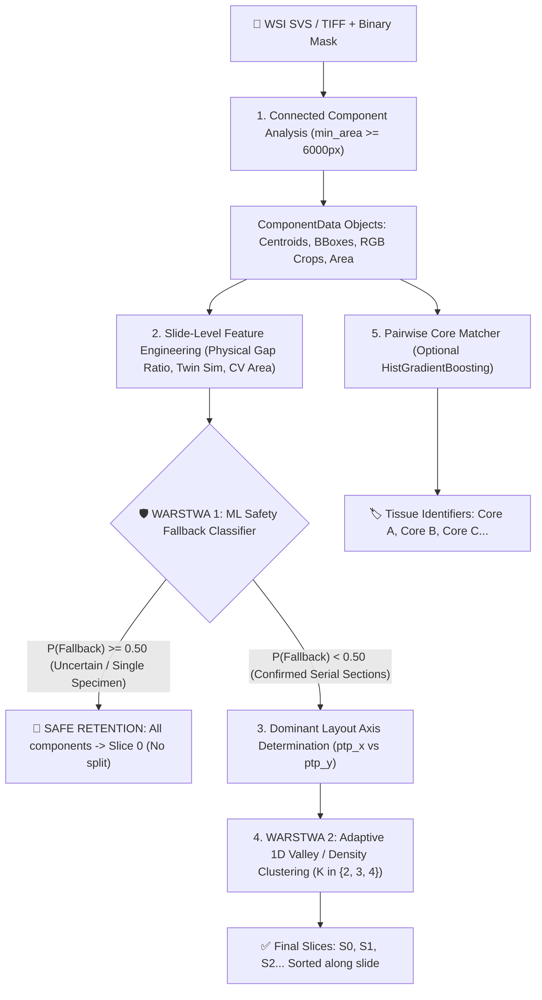

# 🔬 WSI Histopathology SliceGrouper: System Architecture & Design

> **Document Version:** 2.0  
> **Target Application:** 4Diagnosis Whole Slide Image (WSI) Digital Pathology Pipeline  
> **Key Objective:** Automatic grouping of fragmented biopsy components into physical serial sections ("slices"), with an absolute zero-tolerance constraint on false splits of single specimens.

---

## 1. Clinical Context & Design Imperative

In whole slide digital pathology, glass slides often contain multiple cuts (serial sections) of a biopsy, or conversely, a single tissue biopsy fragmented during histology processing:

```
Scenario A (Multi-Slice Serial Sections):       Scenario B (Single Fragmented Tissue):
┌──────────────────────────────────────┐        ┌──────────────────────────────────────┐
│  [Core A1] [Core B1]   <- Slice 0   │        │  [Tissue piece 1]                    │
│                                      │        │     \                                │
│  [Core A2] [Core B2]   <- Slice 1   │        │      [Tissue piece 2]  <- Single    │
│                                      │        │     /                      specimen  │
│  [Core A3] [Core B3]   <- Slice 2   │        │  [Tissue piece 3]                    │
└──────────────────────────────────────┘        └──────────────────────────────────────┘
 Goal: Group into 3 distinct slices               Goal: KEEP INTACT as Slice 0
 Registration merges corresponding cuts           FALSE SPLIT DESTROYS MORPHOLOGY
```

### The Critical Asymmetry
- **False Merge (Under-splitting):** If a 2-slice slide is left as 1 slice, the downstream application skips cross-slice alignment. Sub-optimal, but **zero morphological data is lost**.
- **False Split (Over-splitting):** If a single specimen is erroneously cut into two artificial slices, downstream registration algorithms attempt to non-linearly warp and cross-fuse distinct parts of the same specimen over each other. **This destroys clinical tissue morphology.**
- **Rule of Safety:** When in doubt or ambiguous, the pipeline **MUST default to Full-Slide Retention (`slice_labels = [0, 0, ..., 0]`)**.

---

## 2. End-to-End Pipeline Architecture



---

## 3. Detailed Component Breakdown

### Stage 1: Component Detection & Denoising
- **Input:** Pyramid TIFF level 0 or downsampled WSI overview, paired with tissue mask from `mask.py`.
- **Threshold:** `min_area_px = 6000` pixels.
  - Rejects micro-debris, dust specks, single desquamated cells, and glass scratches.
- **Output:** Container objects `ComponentData` containing:
  - Bounding box $(x, y, w, h)$, Centroid $(c_x, c_y)$, Area in pixels ($A_i$).
  - `rgb_crop` and `mask_crop` for feature computation.

---

### Stage 2: Physical & Morphological Feature Engineering
For any slide with $N \ge 2$ components, an 8-dimensional feature vector is computed:

| Feature Name | Mathematical Definition | Physical Meaning in Histology |
| :--- | :--- | :--- |
| **`N_components`** | $N$ | Total tissue count after dust filtering. |
| **`gap_ratio`** | $\frac{\max(\Delta \text{pos}_{\text{sorted}})}{\text{median}(\text{tissue\_width})}$ | Ratio between the largest empty gap between tissue along the layout axis and median tissue size. $gap < 2.0 \implies$ broken single piece. $gap > 3.5 \implies$ distinct cuts. |
| **`area_cv`** | $\frac{\sigma_A}{\mu_A + \epsilon}$ | Coefficient of variation of component areas. Low CV $\implies$ identical serial cuts. High CV $\implies$ main body + small debris fragments. |
| **`area_min_max`** | $\frac{\min(A)}{\max(A) + \epsilon}$ | Area ratio between smallest and largest pieces. |
| **`dist_cv`** | $\frac{\sigma_D}{\mu_D + \epsilon}$ | Uniformity of pairwise Euclidean centroid distances. |
| **`max_twin_sim`** | $\max_{i \neq j} \left(1 - D_{\text{cosine}}(\vec{h}_i, \vec{h}_j)\right)$ | Maximum cosine similarity between 315-d color histograms (HSV + Lab). Serial cuts of the same organ exhibit twin color distributions. |
| **`is_singleton`** | $\mathbb{I}(N \le 1)$ | Binary indicator for trivial single component. |
| **`is_pair_triplet`**| $\mathbb{I}(N \in \{2, 3\})$ | Binary flag for small component counts. |

---

### Stage 3: Layer 1 — ML Safety Fallback Gate
- **Algorithm:** Calibrated Logistic Regression with Isotonic probability calibration (`outputs/models/fallback_classifier.joblib`).
- **Objective:** Predict $P(\text{fallback} \mid \text{Slide})$.
- **Loss Penalization:** Asymmetric class weighting:
  $$\mathcal{L} = w_0 \cdot y \log(p) + w_1 \cdot (1 - y) \log(1 - p), \quad \text{where } w_1 = 3.5 \times w_0$$
- **Decision Rule:**
  $$\text{Action} = \begin{cases} \text{Fallback (Keep Full Slide intact)}, & \text{if } P(\text{fallback}) \ge 0.50 \\ \text{Proceed to Spatial Slicing}, & \text{if } P(\text{fallback}) < 0.50 \end{cases}$$

---

### Stage 4: Layer 2 — Adaptive Spatial Slicing (Serial Section Grouper)
When a slide passes the Safety Gate, components must be partitioned into $K \in \{2, 3, 4\}$ serial slices:
1. **Dominant Axis Identification:**
   $$\Delta x = \max(c_x) - \min(c_x), \quad \Delta y = \max(c_y) - \min(c_y)$$
   $$\text{Axis} = \begin{cases} 0 \text{ (Horizontal)}, & \text{if } \Delta x \ge \Delta y \\ 1 \text{ (Vertical)}, & \text{if } \Delta y > \Delta x \end{cases}$$
2. **Adaptive Density Valley Partitioning (Density Gap Detector):**
   - Projects centroids onto the dominant axis: $p_i = c_{i, \text{axis}}$.
   - Sorts positions: $p_{(1)} \le p_{(2)} \le \dots \le p_{(N)}$.
   - Calculates consecutive intervals: $\delta_k = p_{(k+1)} - p_{(k)}$.
   - Identifies significant inter-slice boundaries based on relative valley depth rather than a static pixel threshold.
3. **Canonical Relabeling:** Slices are sorted strictly in physical order ($0, 1, 2, \dots$) along the dominant axis.

---

### Stage 5: Core Matching (Tissue Identification)
- **Algorithm:** Calibrated HistGradientBoosting Classifier (`outputs/models/pairwise_tissue_matcher.joblib`).
- **Feature Space:** 404-dimensional pairwise difference vector (Color histograms, GLCM Haralick textures, shape moments, relative bounding box ratios).
- Matches corresponding cores across serial sections (e.g. Core A in Slice 0 $\leftrightarrow$ Core A in Slice 1).

---

## 4. Evaluation Metrics

1. **Adjusted Rand Index (ARI):**
   Measures clustering accuracy corrected for chance. $\text{ARI} = 1.0$ indicates perfect partition; $\text{ARI} = 0.0$ indicates chance or single-cluster collapse.
2. **Normalized Mutual Information (NMI):**
   Information-theoretic measure of shared entropy between predicted and ground-truth groupings.
3. **Perfect Slice Ratio (%):**
   Exact fraction of slides where every component is assigned to the exact right slice ($100\%$ accuracy).
4. **Safety Retention Rate (%):**
   Fraction of true single-specimen slides that remained 100% intact without false splitting (target: $100\%$).
