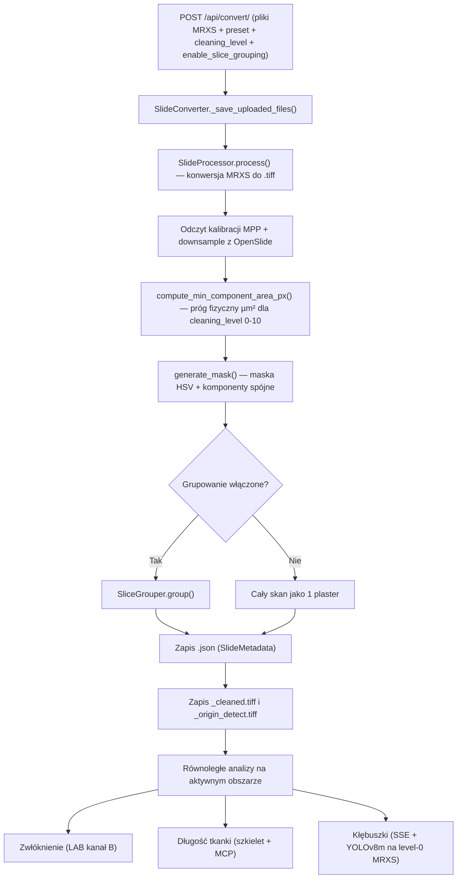

# Architektura Backendu — 4Diagnosis_ComputerVision

Backend aplikacji to serwer REST + SSE w **Django 5.2 (Python 3.12)** odpowiedzialny za:
- przyjmowanie i konwersję całych skanów histopatologicznych `.mrxs` (OpenSlide) do obrazów roboczych `.tiff`,
- skalowalne usuwanie tła i artefaktów,
- automatyczne wykrywanie i grupowanie wielokrotnych cięć seryjnych (**Slice Grouping**),
- analizę zwłóknienia (przestrzeń barw LAB), pomiar długości tkanki (szkieletyzacja + MCP) oraz strumieniową detekcję i klasyfikację kłębuszków nerkowych (YOLOv8m),
- serwowanie pełnych plików TIFF dla analiz oraz lekkich podglądów JPEG dla przeglądarki.

---

## 1. Struktura plików (`backend/cv/`)

```text
backend/cv/
├── manage.py
├── requirements.txt                         # Zależności Python (m.in. Django, OpenSlide, OpenCV, PyTorch, Ultralytics, scikit-learn, joblib)
├── Dockerfile
├── .dockerignore
├── cv/
│   ├── settings.py                          # Centralna konfiguracja (presety S/M/L/XL, progi analiz, parametry SliceGrouper)
│   ├── urls.py                              # Główny routing (/api/ -> myapp.urls)
│   ├── wsgi.py
│   └── asgi.py
└── myapp/
    ├── urls.py                              # Definicje endpointów REST i SSE
    ├── views.py                             # Kontrolery HTTP, obsługa konwersji, przełączania grupowania, analiz i podglądów ?preview=1
    ├── tests.py                             # Testy jednostkowe (skalowanie maski, parytet SliceGrouper, przełączanie grupowania, content-types)
    └── source/
        ├── slide_converter.py               # Orkiestracja konwersji MRXS -> TIFF, kalibracji, maski, grupowania, podglądów i set_grouping()
        ├── processed_image.py               # Fasada łącząca metadane z procesorami (zwłóknienie, długość, kłębuszki)
        ├── streaming_utils.py               # Strumień SSE dla detekcji kłębuszków (z obsługą anulowania po rozłączeniu klienta)
        ├── model/
        │   ├── fallback_classifier.joblib   # Wytrenowany klasyfikator ML (LogisticRegression) dla warstwy Safety Fallback
        │   └── yolov8m_Ludzie01_classification_2026-05-31_oversample2x.pt  # Model YOLOv8m (zdrowe vs zwłóknione kłębuszki)
        └── processors/
            ├── converter_tiff.py            # SlideProcessor: odczyt kafelkowy MRXS na zadanym poziomie piramidy i zapis TIFF
            ├── mask.py                      # Maska tkanki HSV, ekstrakcja komponentów, compute_min_component_area_px(), wizualizacje
            ├── slice_grouper.py             # SliceGrouper: 2-etapowe grupowanie plastrów (ML Safety Fallback + AgglomerativeClustering)
            ├── metadata.py                  # Dataclassy SlideMetadata / CalibrationData / ScanInfo / SliceItem / SlicesInfo + to_summary()
            ├── fibrosis_processor.py        # Analiza zwłóknienia na kanale B przestrzeni LAB + zapis nakładki
            ├── tissue_length_processor.py   # Szkieletyzacja, najdłuższa ścieżka (MCP_Geometric), przeliczenie na mm
            └── glomeruli_processor.py       # Skanowanie kafelkowe poziomu 0 MRXS modelem YOLO + fuzja nakładających się detekcji
```

---

## 2. Przepływ przetwarzania (Pipeline)



---

## 3. Jak działa grupowanie / mergowanie plastrów (`SliceGrouper`)

Na jednym szkiełku histopatologicznym często znajduje się kilka seryjnych skrawków tego samego bioptatu (czasem połamanych na mniejsze fragmenty), a czasem pojedynczy preparat rozbity na kilka kawałków. Zadaniem `SliceGrouper` (`backend/cv/myapp/source/processors/slice_grouper.py`) jest:
1. **rozpoznać**, czy na skanie faktycznie są wielokrotne cięcia seryjne (a nie jeden pofragmentowany preparat),
2. **zmergować** fragmenty należące do tego samego cięcia w osobne plastry (*slices*),
3. **wybrać plaster reprezentatywny**, na którym uruchamiane są późniejsze analizy.

Algorytm działa w **dwóch warstwach**:

### Warstwa 1: ML Safety Fallback Gate (bramka bezpieczeństwa)
Celem tej warstwy jest gwarancja **braku fałszywych podziałów** (gdy nie ma pewności, że skan zawiera wielokrotne cięcia seryjne, lepiej zostawić cały preparat w całości niż uciąć część pojedynczego bioptatu).

1. Dla każdego komponentu spójnego `k` z maski tkanki obliczane są:
   - prostokąt otaczający (`bbox`), powierzchnia w pikselach (`area`),
   - **środek masy pikseli** `(cx, cy) = (mean(xs), mean(ys))`,
   - **315-wymiarowy wektor cech barwnych** (`extract_component_color_vector`):
     - po 9 statystyk (średnia, odchylenie standardowe, skośność dla 3 kanałów) w przestrzeniach **RGB, HSV i Lab** (`3 × 9 = 27` cech),
     - po 3 znormalizowane 32-koszykowe histogramy kanałów w przestrzeniach **RGB, HSV i Lab** (`3 × 96 = 288` cech).
2. Jeśli komponent jest tylko jeden (`N <= 1`), natychmiast zwracany jest 1 plaster bez uruchamiania dalszych etapów.
3. Dla `N >= 2` wyznaczany jest **8-wymiarowy wektor deskryptorów slajdu**:
   - `N` — liczba komponentów tkanki,
   - `area_cv` — współczynnik zmienności powierzchni komponentów,
   - `area_min_max` — stosunek najmniejszej do największej powierzchni,
   - `gap_ratio` — największa luka między sąsiednimi środkami masy wzdłuż osi dominującej (X lub Y, zależnie od rozpiętości skanu) podzielona przez medianę wymiaru komponentów na tej osi,
   - `dist_cv` — współczynnik zmienności odległości parami między środkami masy,
   - `max_twin_sim` — maksymalne podobieństwo kosinusowe między wektorami 315D różnych komponentów (wykrywa bliźniacze seryjne skrawki o tym samym wybarwieniu),
   - `1.0 if N <= 1 else 0.0`,
   - `1.0 if N in (2, 3) else 0.0`.
4. Model `fallback_classifier.joblib` (regresja logistyczna) wyznacza prawdopodobieństwo `fallback_prob = P(fallback)`.
   - Jeśli `fallback_prob >= 0.50` (`SLICE_FALLBACK_THRESHOLD`), uruchamia się **Safety Fallback**: wszystkie komponenty zostają zmergowane w **1 plaster** (`fallback_used = True`, `slice_id = 0`).
   - W razie braku pliku modelu lub błędu ładowania działa zapasowa heurystyka `gap_ratio < 2.5`.

### Warstwa 2: Spatial Agglomerative Clustering (mergowanie fragmentów w plastry)
Gdy bramka ML potwierdzi obecność cięć seryjnych (`fallback_prob < 0.50`):
1. Komponenty są klasteryzowane hierarchicznie (`AgglomerativeClustering`) na podstawie odległości między ich środkami masy `(cx, cy)`:
   - `linkage="average"`,
   - `distance_threshold = max(H, W) * 0.35` (`SLICE_AGGLOMERATIVE_EPS_SCALE`).
   Fragmenty leżące blisko siebie (np. pęknięty jeden skrawek) trafiają do jednego klastra i są scalane (`_merge_comp_infos_to_slice`) w jeden wspólny `bbox_tiff` oraz zsumowaną powierzchnię `area_tiff_px`.
2. Uzyskane klastry (plastry) są sortowane fizycznie wzdłuż dominującej osi slajdu (`0, 1, ..., n_slices - 1`).
3. Jako **plaster reprezentatywny** wybierany jest plaster środkowy: `repr_idx = n_slices // 2`.
4. Współrzędne `bbox_tiff` każdego plastra są przeliczane do pełnej rozdzielczości skanu (`bbox_level0`) z uwzględnieniem przesunięcia kadru (`crop_offset_x`, `crop_offset_y`) i współczynnika `downsample` — dzięki temu detektor kłębuszków na poziomie 0 skanuje dokładnie obszar reprezentanta.

### Ręczne przełączanie grupowania (`set_grouping`)
Metadane (`SlicesInfo` w `<stem>.json`) przechowują zarówno bieżący stan (`items`, `representative_slice_id`), jak i zapamiętany wynik automatycznego grupowania (`auto_items`, `auto_representative_slice_id`):
- **„Nie grupuj” (`grouped=False`):** podmienia `items` na jeden plaster obejmujący cały obraz, ustawia `user_ungrouped=True`, kopiuje `<stem>_cleaned.tiff` na `<stem>_origin_detect.tiff` i usuwa nieaktualne pliki wynikowe analiz (`*_fibrosis.tiff`, `*_length.tiff`, `*_crop*.tiff`, `glomeruli.json`).
- **„Przywróć grupowanie” (`grouped=True`):** odtwarza `auto_items` (lub uruchamia `SliceGrouper` na istniejącym TIFF i masce, jeśli próbka była pierwotnie konwertowana z wyłączonym grupowaniem), wycina podgląd reprezentanta do `<stem>_origin_detect.tiff` i unieważnia stare wyniki analiz.

---

## 4. Endpointy API (`myapp/urls.py`)

| Metoda | Ścieżka | Opis |
| :--- | :--- | :--- |
| `DELETE` | `/api/select-folder/` | Czyści katalog roboczy `backend/cv/slides/` przy wyborze nowego folderu. |
| `POST` | `/api/convert/` | Upload plików `.mrxs`/`.dat`/`.ini`, opcjonalne `conversion_preset` (`S`/`M`/`L`/`XL`), `cleaning_level` (`0`–`10`) i `enable_slice_grouping`. Zwraca `job_id`, URL-e obrazów (`tiff_url`, `cleaned_url`, `origin_detect_url`), `conversion_level`, `cleaning_level` i `slices_summary`. |
| `POST` | `/api/slides/<job_id>/grouping/` | Body `{"grouped": true/false}` — przełącza grupowanie bez ponownego wczytywania MRXS. Zwraca odświeżone URL-e i `slices_summary`. |
| `GET` | `/api/tiff/<job_id>/` | Zwraca surowy plik TIFF (z `?preview=1` dla TIFF ≥ 20 MB zwraca JPEG max 8192 px). |
| `GET` | `/api/result-image/<job_id>/<image_name>/` | Zwraca obrazy podglądów i nakładek analiz (z ochroną przed *path traversal*, obsługą MIME dla `.tiff`/`.jpg`/`.png` i `?preview=1`). |
| `POST` | `/api/fibrosis/` | Body `{"job_id": "...", "threshold": 0.4}` — liczy procent zwłóknienia i generuje nakładkę `*_fibrosis_crop_fibrosis.tiff`. |
| `POST` | `/api/length/` | Body `{"job_id": "..."}` — mierzy długość tkanki w mm i generuje nakładkę `*_length_crop_length.tiff`. |
| `GET` | `/api/glomeruli/stream/?job_id=...` | Strumień **SSE** wysyłający kolejno: `slide_info`, partie `tiles` i `glomeruli` oraz zdarzenie końcowe `done` (zapisuje też `glomeruli.json`). Rozłączenie klienta ustawia `cancel_event` i przerywa skanowanie. |
| `POST` | `/api/glomeruli/count/` | Synchroniczny wariant zliczania kłębuszków (zachowany dla kompatybilności). |

---

## 5. Pliki generowane w katalogu zadania (`slides/<job_id>/`)

Po konwersji i analizach katalog pojedynczego skanu zawiera:
- `<stem>.mrxs` + `<stem>/` (`Index.dat`, `Data*.dat`, `Slidedat.ini`) — oryginalny skan,
- `<stem>.tiff` — surowy obraz skonwertowany na wybranym poziomie piramidy,
- `<stem>_mask.tiff` — binarna maska tkanki po skalowalnym czyszczeniu artefaktów,
- `<stem>_cleaned.tiff` — cały skan z wyczyszczonym tłem (białe tło),
- `<stem>_origin_detect.tiff` — aktywny podgląd (wycinek reprezentanta albo kopia `cleaned`),
- `<stem>.json` — ujednolicone metadane (`SlideMetadata`: kalibracja, wymiary, plastry, stan grupowania),
- `<stem>_fibrosis_crop.tiff`, `<stem>_fibrosis_crop_fibrosis.tiff` — roboczy wycinek i nakładka zwłóknienia,
- `<stem>_length_crop.tiff`, `<stem>_length_crop_mask.tiff`, `<stem>_length_crop_length.tiff` — roboczy wycinek, maska i wizualizacja długości,
- `glomeruli.json` — zapisana lista wykrytych kłębuszków.

---

## 6. Kluczowe ustawienia (`backend/cv/cv/settings.py`) i testy

Najważniejsze parametry w `settings.py`:
- `CONVERSION_LEVEL_PRESETS = {"S": 7, "M": 5, "L": 4, "XL": 3}`, `CONVERSION_DEFAULT_PRESET = "L"`
- `CLEANING_LEVEL_AREA_UM2` (`0` = `0 µm²`, domyślnie `5` = `90 000 µm²`, `10` = `1 500 000 µm²`), `CLEANING_DEFAULT_LEVEL = 5`, `SLICE_MIN_AREA = 6_000` (fallback bez MPP)
- `ENABLE_SLICE_GROUPING = True`, `SLICE_GROUPER_USE_FALLBACK_ML = True`, `SLICE_FALLBACK_THRESHOLD = 0.50`, `SLICE_AGGLOMERATIVE_EPS_SCALE = 0.35`
- `FIBROSIS_THRESHOLD = 0.4`, `FIBROSIS_SLICE_MODE = "one-slice"`
- `YOLO_CONF = 0.15`, `YOLO_IOU = 0.3`, `YOLO_IMG_SIZE = 1024`, `GLOMERULI_TILE_SIZE = 4000`, `GLOMERULI_OVERLAP = 500`, `GLOMERULI_BATCH_SIZE = 16`

Uruchamianie testów jednostkowych z katalogu `backend/cv`:
```bash
python manage.py test myapp -v 2
```
